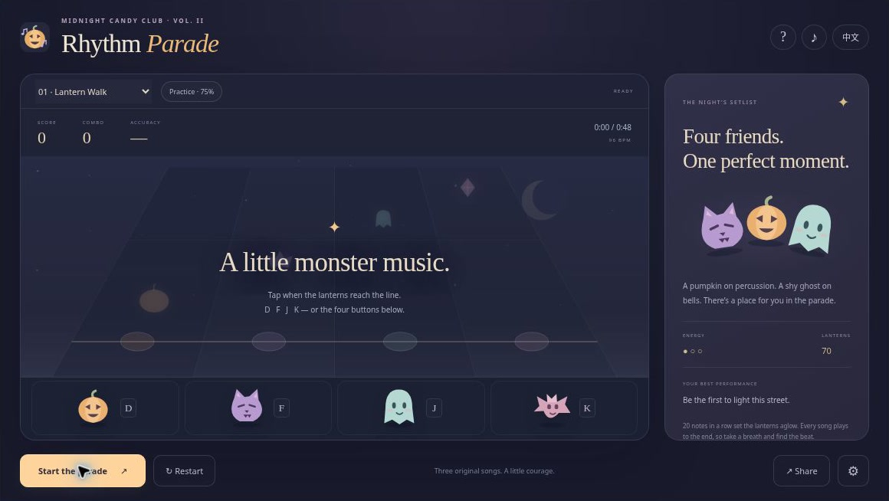
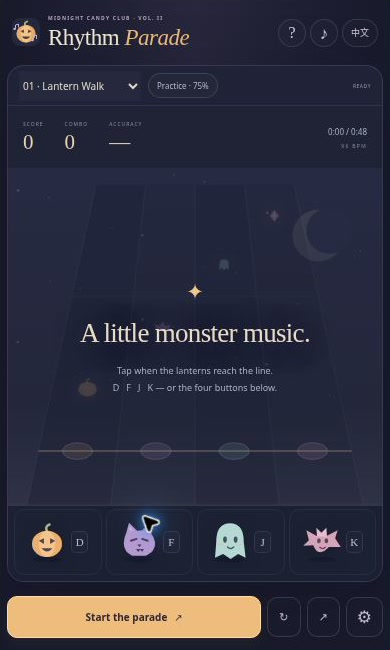

[English](README.md) | [简体中文](README.zh-CN.md) | [Español](README.es.md) | [Português (Brasil)](README.pt-BR.md) | [日本語](README.ja.md)

# 🎃 Midnight Rhythm Parade — 原创音乐万圣节节奏游戏

**四只小怪物，三首原创曲，一条亮起南瓜灯的街道。** Midnight Rhythm Parade 是为 [Sprunki Game](https://sprunki-game.top/) 创作的四轨浏览器音乐游戏。在音符到达金色判定线时敲下节拍，让连击点亮巡游，也可以放慢整张谱面温柔练习。南瓜、猫咪、幽灵和蝙蝠已经准备好出发。

**[在线试玩](https://halloween-rhythm-parade.crazy3d.org/)** · [万圣节游戏总合集](https://github.com/AshinTop/halloween-games) · [嵌入说明](EMBEDDING.md) · [设计说明](DESIGN.md)

**文档语言：** English、简体中文、Español、Português (Brasil)、日本語。**游戏界面目前仅支持英语和简体中文**；西班牙语、葡萄牙语和日语版本为完整说明文档，并非已实现的界面翻译。



## 加入午夜巡游 👻

- 三首完整原创曲，通过浏览器 Web Audio 合成播放。
- 四种音符形状与怪物按钮，以形状和轨道辅助颜色辨识。
- 实际时间判定，20 连击触发灯笼狂热，连击加分最高 50%。
- **75% 速度练习模式**、暂停与继续、本地记录和歌曲分享链接。
- **−150 至 +150 毫秒**的时间偏移调节，声音可关闭。

## 曲目表

| 曲目 | 速度 | 音符数 | 正常速度时长 |
|---|---:|---:|---:|
| Lantern Walk / 南瓜灯的散步 | 96 BPM | 70 | 48.5 秒 |
| Velvet Wings / 天鹅绒蝠翼 | 112 BPM | 133 | 50.3 秒 |
| Midnight Confetti / 午夜糖果雨 | 126 BPM | 168 | 48.6 秒 |

时长包含四拍预备拍。第一首节奏温和，第二首加入切分和双押，第三首带来更快的音型。旋律、振荡器乐器与确定性噪声打击乐均为本项目创作，不是下载来的第三方录音。

## 怎么玩

选择歌曲，可选练习模式，然后点击**开始巡游**。声音在操作后启动。音符落到金色目标线上时，按下对应轨道；两颗音符同时到达时，需要同时按两个轨道。

**±55 毫秒**内为 Perfect，**±115 毫秒**内为 Good，**±180 毫秒**内为 Okay。漏音会中断连击，但歌曲继续，没有提前淘汰的血条。连续命中 20 次会点亮灯笼狂热。结束后可查看得分、准确率、最佳连击和各类判定数量。

练习模式保留完整谱面，以 75% 速度进行，不会覆盖正常速度的最佳成绩。可以根据设备感觉调整时间偏移；这个设置并不消除设备或音频输出本身的延迟。

## 操作

| 操作 | 键盘 | 触屏或鼠标 |
|---|---|---|
| 第 1–4 轨 | D、F、J、K | 四个怪物按钮 |
| 开始、暂停、继续 | 焦点不在表单控件时按空格 | 主播放按钮 |
| 选择歌曲 | 聚焦歌曲选择框 | 歌曲选择框 |
| 时间偏移 | 聚焦设置控件 | 齿轮按钮 |
| 帮助、重开、分享 | Tab 和 Enter | 对应按钮 |

支持多点触控双押。长按键盘不会自动连续得分，同一个音符也不能重复计分。

## 保存喜欢的巡游

[天鹅绒蝠翼练习链接](https://halloween-rhythm-parade.crazy3d.org/#song=velvet-wings&practice=1) 可以分享歌曲与速度选择，不会自动播放，也不会上传演奏内容。

语言、声音、偏移设置和正常速度最佳成绩保存在当前浏览器。离开后不会恢复未完成演奏。页面隐藏或音频中断时会自动暂停，返回后点击继续，不会补播积压的音频。

## 常见问题

**这是 Sprunki 模组吗？** 这是原创四轨节奏游戏，与 Pumpkin Jam 同属万圣节合集。

**漏很多音还能玩完吗？** 可以。每首曲子都能进行到结算，可以在失误之后继续找回节奏。

**练习会覆盖纪录吗？** 不会，较慢的练习不影响正常速度纪录。

**测试测量了扬声器延迟吗？** 没有。自动测试验证时钟与调度；实际声音仍取决于浏览器、设备、音量和音频设置。

## 图文与视频



截图来自真实浏览器中的紧凑 iframe，用于说明布局，不代表实体手机性能测试。

[观看 24 秒介绍视频](https://halloween-rhythm-parade.crazy3d.org/intro.html) · [下载带字幕 MP4](docs/media/intro.mp4)。视频无声，由实际游戏截图编排而成，并非连续操作录像。截图和视频记录的是拍摄时的界面，可能早于后续视觉细节更新。

## 嵌入你的站点

```html
<iframe src="https://halloween-rhythm-parade.crazy3d.org/"
  title="Midnight Rhythm Parade"
  style="display:block;width:100%;height:654px;border:0"
  allow="fullscreen" allowfullscreen></iframe>
```

设计窗口包括 1160×654、390×650、390×794 与 844×340 CSS 像素。请使用支持 Canvas 2D、ES 模块和 Web Audio 的当前浏览器。音频受浏览器权限和设备延迟影响；响应式窗口检查不代表所有实体手机都经过验证。

在线版本通过 GitHub 关联部署到 Cloudflare。请为 iframe 设置实际高度，并给主站工具栏留出空间；全屏入口可由主站提供。详细约定见 [EMBEDDING.md](EMBEDDING.md)。

## 本地运行与规则验证

```sh
python3 -m http.server 4173
```

在仓库根目录启动静态服务，再打开 [http://localhost:4173/](http://localhost:4173/)。游戏无需构建或安装依赖。请使用 HTTP(S)，直接双击 `file://` 页面可能阻止 ES 模块加载。运行测试需要 Node.js。

```sh
npm test
```

**13 项测试**覆盖全曲目的模拟全 Perfect 输入、判定边界、重复击打保护、漏音、练习、偏好与分享链接、有限音频调度、冻结标签页跳时、暂停继续、排队音源取消以及过期的异步启动回调。模拟满分不等于人工演奏或声学测试。

游戏源码不依赖账号、远程 API、广告 SDK 或外部素材 CDN。记录保存在当前浏览器，不提供云端同步；Cloudflare 可能另外加入托管脚本与请求日志。可选合成音效遵循浏览器的声音权限。

## 下一段月光小冒险 🍬

- [Pumpkin Jam](https://halloween-sprunki.crazy3d.org/) · [源码](https://github.com/AshinTop/halloween-sprunki) — 组建原创万圣节怪物乐队.
- [Ghostkeeper Maze 3D](https://halloween-haunted-maze.crazy3d.org/) · [源码](https://github.com/AshinTop/halloween-haunted-maze) — 探索第一人称迷宫，接回南瓜灯幽灵.
- [Moonlit Mirrors](https://halloween-mirror-hearts.crazy3d.org/) · [源码](https://github.com/AshinTop/halloween-mirror-hearts) — 让镜像移动的双幽灵一起到家.
- [Trick-or-Treat TriPeaks](https://halloween-tripeaks.crazy3d.org/) · [源码](https://github.com/AshinTop/halloween-tripeaks) — 高低相邻接龙与月亮桥.

## 制作说明与支持

为 **AshinTop 的 Midnight Candy Club** 创作，设计、编程、文案、测试与审查由人类指导的 AI 协作完成。原创插画和浏览器合成声音为本项目制作，创作意图可见 [设计说明](DESIGN.md)。

喜欢这段小冒险？欢迎 **[给 Midnight Rhythm Parade 点一颗 GitHub Star](https://github.com/AshinTop/halloween-rhythm-parade)**，方便收藏并关注更新。反馈问题时，请附关卡或模式、浏览器、窗口大小和复现步骤。还可以逛逛 [完整万圣节合集](https://github.com/AshinTop/halloween-games)。
